<p align="center">
  
</p>

<h1 align="center">Hola 👋, Soy Esteban Molina Bohorquez </h1>
<p align="center">
  <a href="https://github.com/DenverCoder1/readme-typing-svg"></a>
</p>

<br>

<p align="center"> 
	 
</p>

## <picture></picture> Sobre mí

<picture> </picture>

Soy **programador y estudiante de noveno semestre de Ingeniería de Software** en la [Universitaria de Colombia](https://www.universitariadecolombia.edu.co/). Me enfoco en el **desarrollo full-stack**, la creación de interfaces web y la **automatización de procesos con APIs e inteligencia artificial**.

Me gusta conectar las necesidades del usuario con soluciones técnicas claras: desde diseñar un flujo de registro hasta integrar servicios, construir herramientas internas y mejorar procesos existentes.

- 🎓 **Formación:** Noveno semestre de Ingeniería de Software.
- 💼 **Actualidad:** Trabajo como **programador**, participando en desarrollo de software y soluciones web.
- 💻 **Enfoque:** React, Next.js, TypeScript, Node.js e integraciones.
- 🤖 **Intereses técnicos:** IA aplicada, MCP, agentes, automatización y DevSecOps.
- 📍 **Ubicación:** Bogotá, Colombia.
- 📫 **Contacto:** [estivan2309@gmail.com](mailto:estivan2309@gmail.com).

<br clear="right"/>

---

## 🤝 Cómo trabajo

- **Orientado a problemas reales:** parto de lo que necesita el usuario antes de escoger una tecnología.
- **Visión de producto:** considero usabilidad, navegación y objetivos del negocio al desarrollar una funcionalidad.
- **Desarrollo iterativo:** organizo tareas en entregables verificables y ajusto a partir de feedback.
- **Integración y automatización:** conecto APIs, servicios y herramientas para reducir trabajo manual.
- **Aprendizaje continuo:** experimento con nuevas tecnologías, agentes de IA y herramientas de desarrollo.

---

## 💼 Experiencia

### Programador — Desarrollo de software *(actualidad)*

Participación en el desarrollo de soluciones digitales, con trabajo en interfaces web, ajustes de funcionalidades e integraciones. Actualmente colaboro en el ecosistema **Gran Titán / LosUsados**, abordando flujos de registro, experiencia de usuario y funcionalidades del frontend.

### Prácticas de desarrollo — Valle del Software *(experiencia previa)*

Participación en proyectos de desarrollo web, automatización e integración de servicios, incluyendo sistemas de turnos, asistentes basados en MCP y flujos para campañas publicitarias mediante APIs.

---

## 🚀 Proyectos y experiencia aplicada

### Sistema de turnos para IPS — *React · Node.js · Express*

Desarrollo de una solución de atención por turnos con generación de tickets, panel de operador, visualización de llamados y componentes orientados a la experiencia de pacientes y personal de atención.

### Asistentes universitarios con MCP — *MCP · APIs · Automatización*

Trabajo en asistentes para consultas de información institucional y de servicios, utilizando herramientas conectadas a través de **Model Context Protocol (MCP)**.

### Automatización de Meta Ads — *Go · Meta API · IA*

Desarrollo e integración de procesos para apoyar la creación de campañas, formularios de leads y contenido publicitario mediante APIs y modelos de IA.

### Gran Titán / LosUsados — *Frontend · UX · Integraciones*

Trabajo en la experiencia de registro y afiliación del ecosistema automotriz, con enfoque en **landing pages**, formularios integrados en una sola página, navegación e integración de flujos entre servicios.

> Algunos desarrollos corresponden a proyectos internos o privados, por lo que no se incluyen enlaces a repositorios.

---

## 🛠️ Tecnologías y herramientas

### <picture>   </picture> Lenguajes de Programación

<p align="center">
  &emsp;
  <a href="https://www.cplusplus.com/" target="_blank">
    
  </a>
  &emsp;
  <a href="https://www.cprogramming.com/" target="_blank">
    
  </a>
  &emsp;
  <a href="https://www.python.org" target="_blank">
    
  </a>
  &emsp;
  <a href="https://developer.mozilla.org/en-US/docs/Web/JavaScript" target="_blank">
    
  </a>
  &emsp;
  <a href="https://www.typescriptlang.org/" target="_blank">
    
  </a>
  &emsp;
  <a href="https://www.java.com" target="_blank">
    
  </a>
  &emsp;
  <a href="https://docs.microsoft.com/en-us/dotnet/csharp/" target="_blank">
    
  </a>
  &emsp;
  <a href="https://golang.org" target="_blank">
    
  </a>
  &emsp;
  <a href="https://www.php.net/">
    
  </a>
</p>

### <picture>   </picture> Frontend

<p align="center">
  &emsp;
  <a href="https://www.w3.org/html/" target="_blank">
    
  </a>
  &emsp;
  <a href="https://www.w3schools.com/css/" target="_blank">
    
  </a>
  &emsp;
  <a href="https://tailwindcss.com/" target="_blank">
    
  </a>
  &emsp;
  <a href="https://reactjs.org/" target="_blank">
    
  </a>
  &emsp;
  <a href="https://nextjs.org/" target="_blank">
    
  </a>
</p>

### <picture>   </picture> Backend & Mobile

<p align="center">
  &emsp;
  <a href="https://nodejs.org" target="_blank">
    
  </a>
  &emsp;
  <a href="https://bun.sh/" target="_blank">
    
  </a>
  &emsp;
  <a href="https://expressjs.com" target="_blank">
    
  </a>
  &emsp;
  <a href="https://reactnative.dev/" target="_blank">
    
  </a>
  &emsp;
  <a href="https://flutter.dev" target="_blank">
    
  </a>
</p>

### <picture>   </picture> Bases de Datos & Cloud

<p align="center">
  &emsp;
  <a href="https://www.mysql.com/" target="_blank">
    
  </a>
  &emsp;
  <a href="https://www.sqlite.org/" target="_blank">
    
  </a>
  &emsp;
  <a href="https://aws.amazon.com" target="_blank">
    
  </a>
  &emsp;
  <a href="https://firebase.google.com/" target="_blank">
    
  </a>
</p>

### <picture>   </picture> Herramientas de Desarrollo

<p align="center">
  &emsp;
  <a href="https://git-scm.com/" target="_blank">
    
  </a>
  &emsp;
  <a href="https://github.com/" target="_blank">
    
  </a>
  &emsp;
  <a href="https://www.docker.com/" target="_blank">
    
  </a>
  &emsp;
  <a href="https://code.visualstudio.com/" target="_blank">
    
  </a>
</p>

### 🤖 Inteligencia Artificial, Integraciones y Automatización

<p align="center">
  
  
  
  
  
</p>

**Áreas de aplicación:** consumo e integración de APIs REST, herramientas MCP, automatización de tareas, orquestación asistida por agentes y flujos de trabajo con IA.

### <picture>   </picture> Sistemas Operativos

<p align="center">
  &emsp;
  <a href="https://www.microsoft.com/windows"></a>
  &emsp;
  <a href="https://www.kali.org/"></a>
  &emsp;
  <a href="https://www.kernel.org/"></a>
</p>

<br>

---

## ⚡ Mi perfil en código

```typescript
const esteban = {
  formacion: "Ingeniería de Software — 9.º semestre",
  rolActual: "Programador",
  enfoque: ["Full Stack", "Frontend", "Integraciones"],
  tecnologias: ["TypeScript", "React", "Next.js", "Node.js", "Python", "Go"],
  intereses: ["IA aplicada", "MCP", "Automatización", "DevSecOps"],
  objetivo: "Crear software útil, mantenible y centrado en las personas",
};
```

<h2 align="center">Conecta conmigo 🤝</h2>

<!--icons and links-->
<p align="center">
<a href="https://www.linkedin.com/in/esteban-molina-bohorquez/" target="blank"></a>
<a href="https://www.instagram.com/stev4mpp_dmc/" target="blank"></a>
<a href="https://discord.gg/3Ck9Ec4F" target="blank"></a>
<a href="mailto:estivan2309@gmail.com" target="blank"></a>
</p>

---

<p align = "center">
	<a href="https://github.com/piyushsuthar/github-readme-quotes"> </a>
</p>

## <picture>   </picture> Estadísticas de GitHub

<details><summary><h3> 🔥 Racha de Commits</h3></summary>

----	

<p align="center"></p>

</details>
  
<details><summary><h3>💻 Estadísticas del Perfil de GitHub</h3></summary>

---

<p align="center">
  
  
</p>

<p align="center"><sub>Los lenguajes representan únicamente los repositorios analizados; no equivalen a mi nivel de experiencia.</sub></p>

</details>

<details><summary><h3>⚡ Actividad Reciente en GitHub</h3></summary>

----
	
[](https://github.com/ashutosh00710/github-readme-activity-graph)

</details>

## 🏆 Trofeos del Perfil Git

<p align="center">
  
</p>

## 🐍 Una Serpiente Comiéndose mi Gráfico de Contribuciones

<p align="center">
  
</p>

---

<p align="center">
  
</p>
